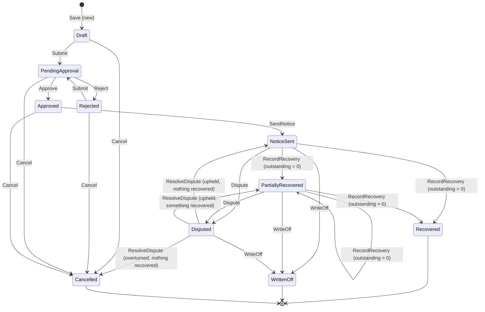

# COBLink API reference (baseline v1)

This document is the contract between the Angular client, the ASP.NET Core API, the business layer and the database.
It describes the **legacy baseline** exactly as it behaves today. During modernization every change to this contract
must be deliberate (see the "Legacy to target" map in the [README](../README.md)).

* Base path: `/api` (same origin as the SPA; no CORS).
* Source of truth for shapes: `src/CobLink.Models` (C#) mirrored by `client/src/app/models` (TypeScript).
* Live, generated documentation: `/swagger` when the API runs in the Development or Demo environment.

## 1. Conventions

| Topic | Rule |
|---|---|
| Routing | RPC style: `api/{Controller}/{Action}`. Reads are `GET` (id passed as `?id=`), everything with a body is `POST`. |
| JSON | Newtonsoft.Json, **camelCase** property names, enums as **numbers**, decimals as numbers, `byte[]` as base64 string. |
| Timestamps | `*Date` audit/event timestamps are UTC and end in `Z`, for example `2025-03-14T16:22:05.1234567Z`. |
| Date-only values | `dueDate`, `noticeDate`, `dateOfService`, `recoveryDate`, `dateOfBirth` have no time zone: `2025-03-14T00:00:00`. Clients send `yyyy-MM-dd`. |
| Optimistic concurrency | Every `Activity` and `Takeback` carries `rowVersion` (base64). Send it back unchanged on every write. |
| Paging | `pageNumber` (1-based, default 1), `pageSize` (default 20, max 100), `sortBy` (camelCase key from section 6), `sortDescending`. |
| Authentication | Production: Windows (Negotiate / Kerberos / NTLM). Development, Testing and Demo: the `X-CobLink-User` request header (for example `CORP\jdoe`), falling back to `Authentication:DevelopmentUser`. |
| Authorization | Roles come from the `AppUser` table (`Analyst`, `Supervisor`, `Admin`), not from AD groups. Unknown or inactive users get `403`. |

### Response envelope

Every `/api` response uses the same envelope (`ServiceResponse<T>`):

```json
{
  "success": true,
  "message": null,
  "errorCode": null,
  "errors": [],
  "data": { }
}
```

| Situation | HTTP | `success` | `errorCode` | Notes |
|---|---|---|---|---|
| OK | 200 | true | null | `data` holds the result |
| Field validation failed | 200 | false | `VALIDATION` | `errors[]` = `{ "field": "subject", "message": "..." }`, `field` is camelCase or null |
| Business rule broken (record in the wrong state, a closed record, amounts above what is outstanding) | 200 | false | `BUSINESS_RULE` | `message` is user readable |
| Not found | 200 | false | `NOT_FOUND` | |
| Stale `rowVersion` | 200 | false | `CONCURRENCY` | the client should reload the record |
| Not allowed for this user (role, ownership, separation of duties, approval limit) | 403 | false | `FORBIDDEN` | also returned for unregistered or inactive users; `message` says why |
| Not authenticated | 401 | n/a | n/a | Negotiate challenge, no envelope |
| Malformed request body | 400 | false | `BAD_REQUEST` | |
| Unhandled error | 500 | false | `SERVER_ERROR` | `message` contains a trace id |

Failures with HTTP 200 are a deliberate legacy trait. The target REST API uses 400/404/409/422 with RFC 9457 problem details.

## 2. Endpoints

| Method | Route | Request | `data` |
|---|---|---|---|
| GET | `/api/User/GetCurrent` | | `SessionInfo` |
| GET | `/api/User/GetAll` | | `AppUser[]` (active users) |
| GET | `/api/Lookup/GetAll` | | `LookupData` |
| GET | `/api/Lookup/SearchMembers?term=&max=` | term of 2+ characters, max default 15 (cap 50) | `Member[]` |
| GET | `/api/Lookup/SearchProviders?term=&max=` | same | `Provider[]` |
| GET | `/api/Dashboard/GetSummary` | | `DashboardSummary` |
| POST | `/api/Activity/Search` | `ActivitySearchRequest` | `PagedResult<ActivityListItem>` |
| GET | `/api/Activity/GetById?id=` | | `Activity` |
| POST | `/api/Activity/Save` | `SaveActivityRequest` | `Activity` |
| POST | `/api/Activity/Complete` | `ActivityActionRequest` (comment = outcome, required) | `Activity` |
| POST | `/api/Activity/Reopen` | `ActivityActionRequest` (comment optional) | `Activity` |
| POST | `/api/Activity/Cancel` | `ActivityActionRequest` (comment = reason, required) | `Activity` |
| POST | `/api/Activity/AddNote` | `AddActivityNoteRequest` | `Activity` |
| POST | `/api/Takeback/Search` | `TakebackSearchRequest` | `PagedResult<TakebackListItem>` |
| GET | `/api/Takeback/GetById?id=` | | `Takeback` |
| POST | `/api/Takeback/Save` | `SaveTakebackRequest` | `Takeback` |
| POST | `/api/Takeback/Submit` | `TakebackActionRequest` | `Takeback` |
| POST | `/api/Takeback/Approve` | `TakebackActionRequest` | `Takeback` |
| POST | `/api/Takeback/Reject` | `TakebackActionRequest` (comment required) | `Takeback` |
| POST | `/api/Takeback/SendNotice` | `TakebackActionRequest` | `Takeback` |
| POST | `/api/Takeback/RecordRecovery` | `RecordRecoveryRequest` | `Takeback` |
| POST | `/api/Takeback/Dispute` | `TakebackActionRequest` (comment required) | `Takeback` |
| POST | `/api/Takeback/ResolveDispute` | `ResolveDisputeRequest` (comment required) | `Takeback` |
| POST | `/api/Takeback/WriteOff` | `TakebackActionRequest` (comment required) | `Takeback` |
| POST | `/api/Takeback/Cancel` | `TakebackActionRequest` (comment required) | `Takeback` |
| GET | `/health` | anonymous, not enveloped | `{ "status": "Healthy", "database": "Up", "version": "1.0.0", "environment": "Development", "time": "..." }` (503 when the database is down) |

Types referenced above are the classes in `src/CobLink.Models` (camelCase on the wire). Single-record responses always
include `availableActions`: the names of the actions the **current user** may perform on that record right now. Clients
must use it to show or hide buttons instead of re-implementing the rules.

## 3. Activity tracking rules

An **activity** is a unit of work an analyst tracks: a call, a letter, a verification, and so on. It can belong to a member,
to a takeback, or both, or it can be a general activity with neither (for example a quarterly documentation audit).

| Rule | Detail |
|---|---|
| Linking | `memberId` and `takebackId` are both optional (a general activity has neither). With a takeback the member is derived from it and a supplied `memberId` must match; a supplied `memberId` must exist. |
| Create defaults | `status` Open, `assignedToUserId` = current user when omitted. |
| Fields | `subject` required, max 200. `description` max 4000. `activityType`/`priority` must be valid enum values. `status` must be Open or InProgress on Save. |
| Due date | Optional. On **create** it cannot be before today. |
| Assignee | Must be an active user. |
| Editing | Only Open and InProgress activities can be saved. Completed and Cancelled are read-only until **Reopen**. |
| Complete | Open or InProgress to Completed. `comment` (outcome, max 1000) required. Sets `completedDate` and `outcome`. |
| Cancel | Open or InProgress to Cancelled. `comment` (reason) required. |
| Reopen | Completed or Cancelled to Open. Clears `completedDate` and `outcome`. |
| Permission | Supervisor and Admin may change any activity. An Analyst may change an activity they created or are assigned to. Any registered user may add a note. |
| System notes | Create, Complete, Cancel, Reopen, assignee change and status change each add a note with `isSystem = true`. |
| Overdue | `isOverdue` = due date passed while Open or InProgress (calculated by SQL). |

`availableActions` values: `Edit`, `Complete`, `Reopen`, `Cancel`, `AddNote`.

## 4. Takeback rules

A **takeback** is the recoupment of money paid on a claim, typically because another carrier turned out to be primary
(this is the Coordination of Benefits, or COB, domain).

### Status flow



### Rules per action

| Action | From | Who | Rules |
|---|---|---|---|
| Save | new, Draft, Rejected | creator, Supervisor, Admin | Field rules below. A Rejected takeback stays Rejected until it is submitted again. |
| Submit | Draft, Rejected | creator, Supervisor, Admin | Re-validates the saved data. |
| Approve | PendingApproval | Supervisor, Admin | The approver cannot be the creator (separation of duties). Amounts above `Takeback:HighValueThreshold` (default 25000) need an Admin. Stamps `approvedBy`/`approvedDate`. |
| Reject | PendingApproval | same as Approve | `comment` required. |
| SendNotice | Approved | any registered user | `noticeDate` = today, `dueDate` = today + `Takeback:ResponseWindowDays` (default 30). |
| RecordRecovery | NoticeSent, PartiallyRecovered | any registered user | `amount` > 0, at most 2 decimals and not more than the outstanding amount; `recoveryDate` not in the future and not before `noticeDate`; `referenceNumber` required for Check and Eft. Moves to Recovered when nothing is outstanding, otherwise PartiallyRecovered. |
| Dispute | NoticeSent, PartiallyRecovered | any registered user | `comment` required. |
| ResolveDispute | Disputed | Supervisor, Admin | `comment` required. `upheld = true` restarts the response window (`dueDate` = today + window) and returns the takeback to NoticeSent (or PartiallyRecovered when something was already recovered); `upheld = false` cancels the takeback, which is refused with a `BUSINESS_RULE` error once a recovery has been recorded (write it off instead). |
| WriteOff | NoticeSent, PartiallyRecovered, Disputed | Supervisor, Admin | `comment` required. |
| Cancel | Draft, PendingApproval, Approved, Rejected | creator, Supervisor, Admin | `comment` required. |

Every status change and every edit writes a `history` entry (`action`, `fromStatus`, `toStatus`, `comment`, who, when).

### Balances

`outstandingAmount` is `takebackAmount - recoveredAmount` for **every** status, so it is also reported for Draft, Rejected,
WrittenOff and Cancelled takebacks. Only the dashboard (section 5) limits its money figures to takebacks that are being
collected. The takeback detail page therefore labels that amount "Written off" or "Not pursued" for a WrittenOff or
Cancelled takeback instead of "Outstanding". `availableActions` is the only place where the rules above are evaluated for
the current user: a missing `Approve` can mean separation of duties (the creator) or the high-value limit (a Supervisor),
and the response does not say which.

### Field rules (Save)

| Field | Rule |
|---|---|
| `claimNumber` | Required, max 30, letters, digits and `-` only. |
| `memberId`, `providerId` | Required, must exist. |
| `reason` | Valid `TakebackReason`. |
| `dateOfService` | Required, not in the future. |
| `originalPaidAmount` | Greater than 0, at most 2 decimals, not more than 9,999,999.99. |
| `takebackAmount` | Greater than 0, not more than `originalPaidAmount`, at most 2 decimals, not more than 9,999,999.99. |
| `otherCarrierName` | Required when `reason` is `OtherInsurancePrimary`; max 150. `otherPolicyNumber` max 50. |
| `notes` | Max 2000. |
| Duplicates | Only one takeback per claim number and provider may exist in any status other than Rejected or Cancelled. |

`availableActions` values: `Edit`, `Submit`, `Approve`, `Reject`, `SendNotice`, `RecordRecovery`, `Dispute`,
`ResolveDispute`, `WriteOff`, `Cancel`.

## 5. Dashboard figures

| Figure | Definition |
|---|---|
| `myOpenActivities` / `myOverdueActivities` | Open or InProgress activities assigned to the current user / the overdue subset. |
| `openActivities` / `overdueActivities` | Same, organisation wide. |
| `activitiesDueThisWeek` | Open or InProgress, due from today through the next 7 days. |
| `activitiesByStatus` / `takebacksByStatus` | One entry per status that has rows (`statusId`, `count`, `amount` for takebacks). |
| `myUpcomingActivities` | Up to 5 of the user's open activities ordered by due date (undated last). |
| `takebacksPendingApproval` | Status PendingApproval. |
| `activeTakebacks` | NoticeSent, PartiallyRecovered or Disputed. |
| `overdueTakebacks` | Due date passed while NoticeSent or PartiallyRecovered. |
| `totalTakebackAmount` / `totalRecoveredAmount` | Over Approved, NoticeSent, PartiallyRecovered, Recovered and Disputed takebacks. |
| `recentTakebacks` | The 5 most recently created takebacks. |

## 6. Sort keys

| Search | Keys (default first) |
|---|---|
| Activity | `dueDate` (ascending, undated last), `activityNumber`, `subject`, `activityType`, `status`, `priority`, `memberName`, `assignedToName`, `createdDate` |
| Takeback | `createdDate` (descending), `takebackNumber`, `claimNumber`, `memberName`, `providerName`, `reason`, `status`, `takebackAmount`, `recoveredAmount`, `outstandingAmount`, `dueDate` |

Unknown keys are rejected with a `VALIDATION` error on `sortBy`.

## 7. Enumerations

| Enum | Values |
|---|---|
| `UserRole` | 1 Analyst, 2 Supervisor, 3 Admin |
| `ActivityType` | 1 PhoneCall, 2 Email, 3 Letter, 4 OtherCarrierVerification, 5 MemberOutreach, 6 ProviderOutreach, 7 DocumentReview, 8 ClaimReview, 9 Research, 10 Other |
| `ActivityStatus` | 1 Open, 2 InProgress, 3 Completed, 4 Cancelled |
| `ActivityPriority` | 1 Low, 2 Normal, 3 High, 4 Urgent |
| `TakebackReason` | 1 OtherInsurancePrimary, 2 MedicarePrimary, 3 DuplicatePayment, 4 EligibilityTerminated, 5 ThirdPartyLiability, 6 WorkersCompensation, 7 ProviderBillingError, 8 Other |
| `TakebackStatus` | 1 Draft, 2 PendingApproval, 3 Approved, 4 Rejected, 5 NoticeSent, 6 PartiallyRecovered, 7 Recovered, 8 Disputed, 9 WrittenOff, 10 Cancelled |
| `RecoveryMethod` | 1 Check, 2 Eft, 3 Offset |

The numeric values are stored in the `Lkp*` tables and hard-coded in `client/src/app/models/enums.ts`.
`GET /api/Lookup/GetAll` returns the display names (`id` equals the enum value, `code` equals the enum name).
